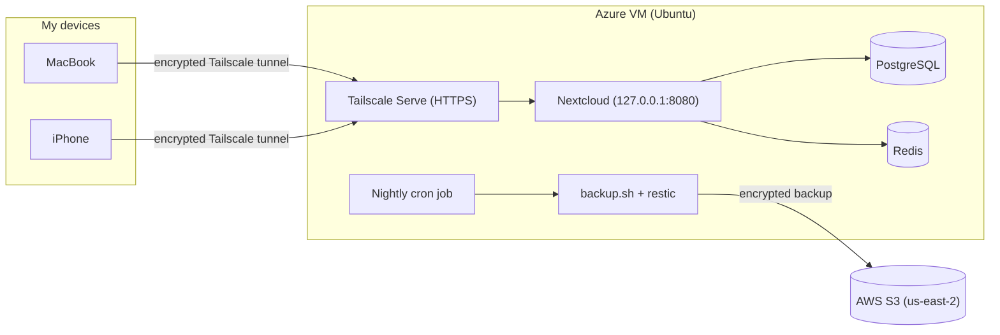
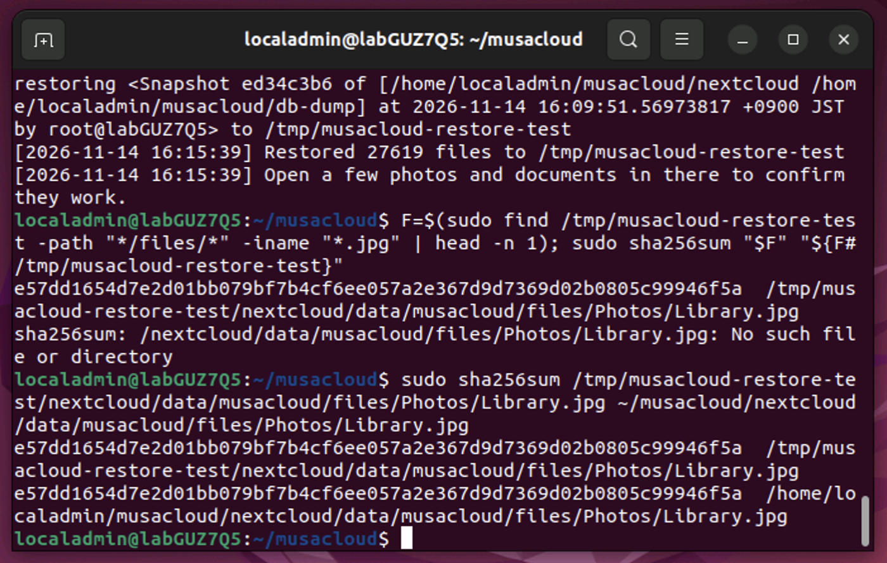
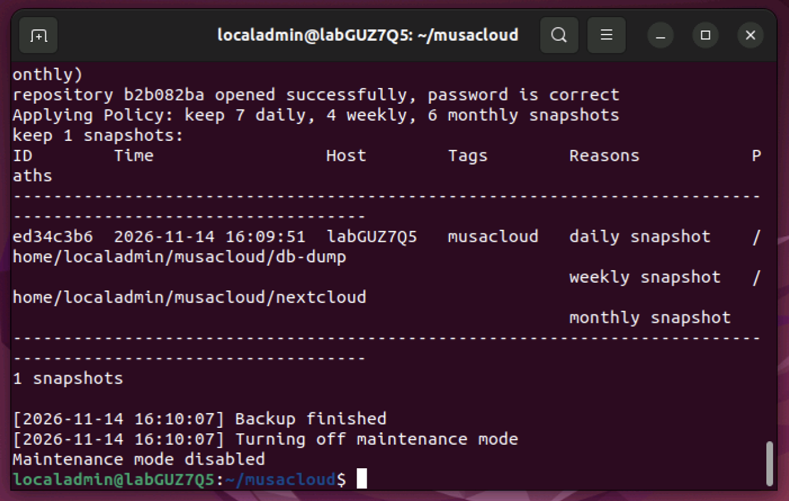
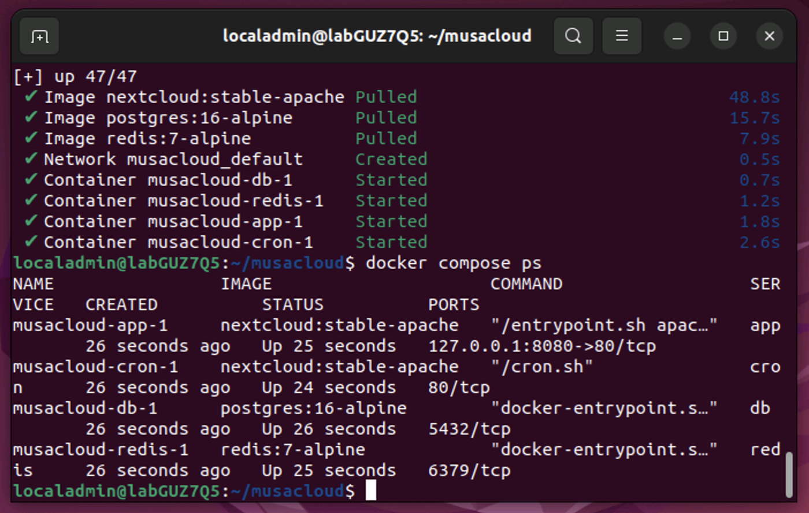
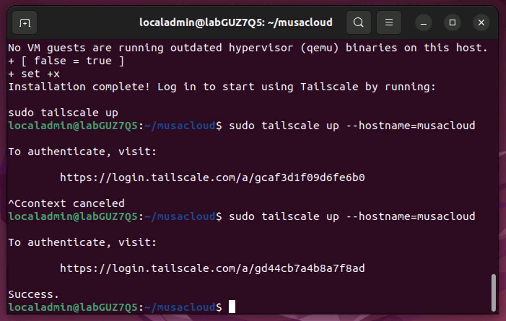
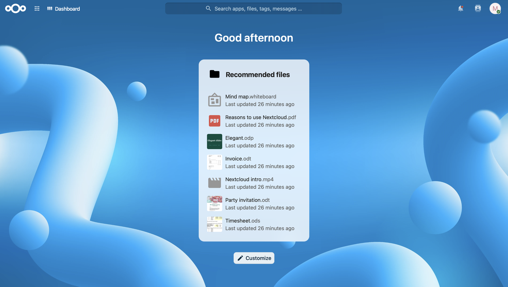
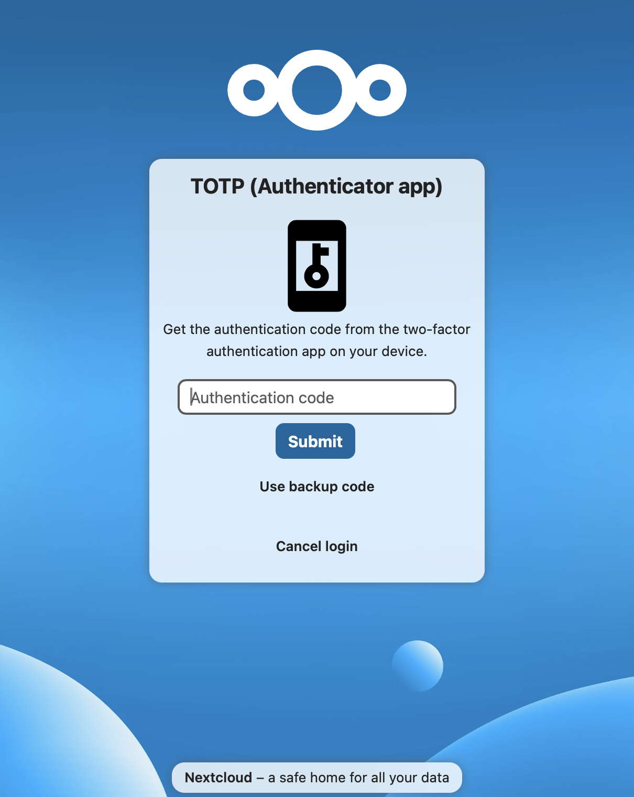
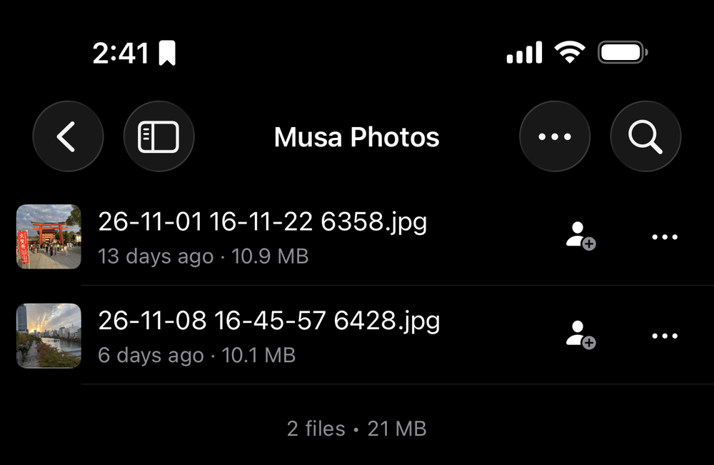
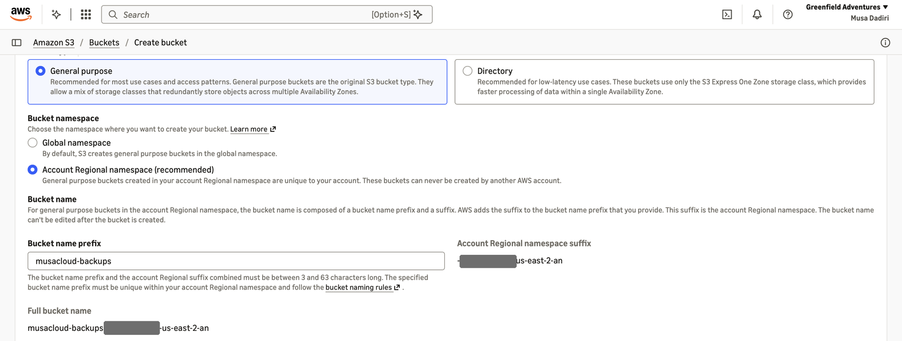

# MusaCloud

**Self-hosted private cloud storage with encrypted off-site backups**

MusaCloud is my own replacement for iCloud storage. It runs Nextcloud in Docker on an Azure Ubuntu 22.04 VM. Only my own devices can reach it, and an encrypted backup goes to AWS S3 every night.

> Built as a portfolio project on a university-provided Azure lab VM, using test files only.

## Why I built it

I didn't want to keep paying for iCloud storage when I could run my own. I also wanted hands-on practice with the skills cloud and security teams use every day: Linux, containers, private networking, cloud storage, access control, and backup and recovery.

## Architecture

My MacBook and iPhone reach MusaCloud through Tailscale, an encrypted private network. Nextcloud only listens inside the VM, so nothing is exposed to the public internet. A nightly job encrypts everything with restic and sends it to Amazon S3.

## Security design

| Decision | Why |
| --- | --- |
| No public ports. Nextcloud listens only on `127.0.0.1`, and Tailscale is the only way in. | Nothing on the internet can find or attack the server. |
| HTTPS through Tailscale certificates | Logins and files are encrypted in transit. |
| Two-factor login (TOTP) | A stolen password alone isn't enough to get in. |
| Backups encrypted by restic before upload | Amazon only ever stores data it can't read. |
| Least-privilege IAM policy | The backup key can touch one bucket and nothing else in the AWS account. |
| S3 "Block all public access" left on | The backup bucket can't be made public by mistake. |
| Secrets kept in `.env`, excluded by `.gitignore` | No passwords or keys ever reach GitHub. |

## Tech stack

Azure VM (Ubuntu) · Docker Compose · Nextcloud · PostgreSQL · Redis · Tailscale · restic · AWS S3 · AWS IAM · cron · Bash

## Results

| Check | Result |
| --- | --- |
| Encrypted backup to S3 | First snapshot created on Nov 14, 2026 |
| Restore test | 27,619 files restored from S3 |
| Integrity check | SHA-256 hash of a restored file matches the original exactly |
| Automation | Backup scheduled to run nightly with cron |

## Documentation

| Document | What's in it |
| --- | --- |
| [Project report (PDF)](docs/MusaCloud-report.pdf) | The full write-up: architecture, build, security, backups and results |
| [Setup guide](docs/setup-guide.md) | How to build MusaCloud from this repo, step by step |
| [Security design and threat model](docs/security.md) | Threats, how each is handled, and the risk that remains |
| [Build log](docs/build-log.md) | Every problem I hit during the build and how I fixed it |

## Screenshots

### Restore verified: matching SHA-256 hashes

### Encrypted backup finished

### Four containers running, Nextcloud bound to 127.0.0.1

### VM joined to my private Tailscale network

### Nextcloud dashboard

### Two-factor login

### Nextcloud iPhone app

### S3 bucket in the account-regional namespace (account ID hidden)

## Challenges and what I learned

- **Adapting to a different environment.** My setup steps were written for a local VirtualBox VM, but my VM was an Azure lab VM reached through remote desktop. I replaced the SSH and port-forwarding steps with the VM's own terminal and adjusted later steps to match.
- **AWS region and bucket-name mismatches.** Backups failed first with `400 Bad Request`, then with a `301` redirect error. My settings had the wrong bucket name and region, including an `-an` suffix from S3's account-regional bucket names that I had copied into the region field by mistake.
- **Hidden files on macOS.** Files starting with a dot were renamed with an underscore during upload, which broke setup until I found them with `ls -a`.
- **Proving a backup works.** A backup isn't real until you restore it, so I restored 27,619 files and compared SHA-256 hashes against the originals.

Full details are in the [build log](docs/build-log.md).

## Hardening checklist

- [x] Private access only through Tailscale, with no public ports
- [x] HTTPS for all connections
- [x] Encrypted, scheduled backups to S3 with a least-privilege IAM key
- [x] Restore verified with SHA-256 hashes
- [x] Two-factor login (TOTP) on my account
- [ ] Enforce two-factor login for every account
- [ ] Separate everyday account from the admin account
- [ ] Resolve remaining Nextcloud setup warnings (database indices, mimetypes, maintenance window)
- [ ] Add an HSTS header

## Next steps

- Send Nextcloud's login logs into my Splunk SIEM project to detect failed login attempts
- Move MusaCloud to always-on hardware or an Azure account of my own
- Test Immich as a photo-focused alternative to Nextcloud

## Repository contents

| File | Purpose |
| --- | --- |
| `docker-compose.yml` | Runs Nextcloud, PostgreSQL, Redis and the background-jobs container |
| `.env.example` | Template for passwords and keys. The real `.env` is never committed. |
| `backup.sh` | Encrypted backups to S3, snapshot listing and restore testing |
| `iam-policy.json` | Least-privilege AWS permissions for the backup key |
| `.gitignore` | Keeps secrets and personal data out of the repo |
| `docs/` | Report, setup guide, threat model, build log and screenshots |
